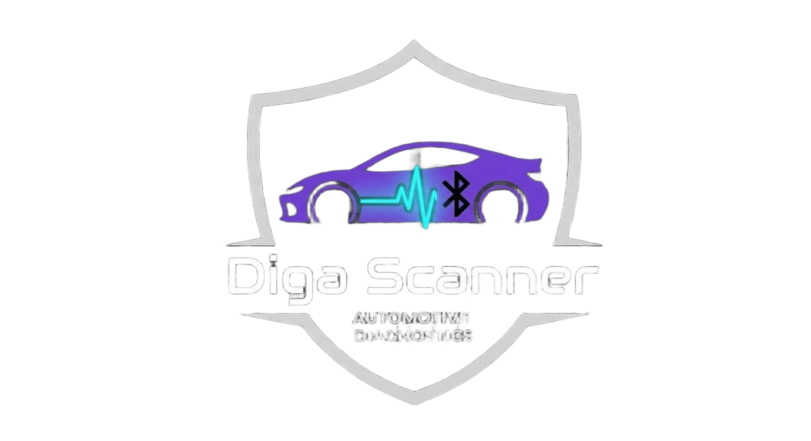

<div align="center">



# CheckDiga Pro

### أداة تشخيص أعطال السيارات عبر OBD2

صُنع بحب في 🇩🇿

[](https://opensource.org/licenses/MIT)
[](https://web.dev/progressive-web-apps/)
[](https://developer.mozilla.org/en-US/docs/Web/API/Web_Bluetooth_API)
[](https://ishakdiga55-ops.github.io/Diga-scaner/)
[]()

تطبيق ويب تقدمي (PWA) يعمل مباشرة من المتصفح — دون تثبيت، دون خادم، ودون اشتراك.

[🚀 تجربة مباشرة](https://ishakdiga55-ops.github.io/Diga-scaner/) ·
[🐛 الإبلاغ عن خطأ](https://github.com/ishakdiga55-ops/Diga-scaner/issues) ·
[💡 طلب ميزة](https://github.com/ishakdiga55-ops/Diga-scaner/issues/new/choose)

</div>

---

## 📖 نبذة سريعة

**CheckDiga Pro** هو تطبيق فحص سيارات يعمل عبر OBD2 ويتيح للمستخدم:

- 📖 قراءة رموز الأعطال (DTC) وتحليلها
- 🧠 تحليل مبدئي للحالات التقنية (المحرك، ABS، الفرامل، العادم، الكهرباء)
- 📊 عرض مؤشرات حية (RPM، السرعة، حرارة المحرك، مستوى الوقود)
- 🌿 فحص جاهزية الانبعاثات
- 🔋 اختبار البطارية والدينامو
- 📋 استعراض تفاصيل دقيقة لكل كود عطل
- 🌐 عمل مباشر داخل المتصفح عبر Web Bluetooth و Web Serial

---

## ✨ المزايا

### 🔌 الاتصال والتشخيص
- ✅ دعم Web Bluetooth عبر ELM327 BLE 4.0
- ✅ دعم Web Serial عبر USB
- ✅ وضع تجريبي لاختبار التطبيق بدون جهاز
- ✅ إعادة الاتصال التلقائية عند الانقطاع
- ✅ كشف تلقائي لـ 10 بروتوكولات OBD2

### 📚 قاعدة بيانات شاملة
- 📦 **15,590 كود عطل** (بعد الدمج الذكي)
- 🏭 تغطية لأكثر من **33 علامة تجارية**
- 🔍 بحث فوري حسب الكود أو الوصف
- 🩺 بحث بالأعراض (اهتزاز المحرك، دخان أسود، ضعف التسارع...)
- 🎯 تصفية حسب مستوى الخطورة
- 🌳 تصفح حسب الفئة (P0xxx، P2xxx، B0xxx، C0xxx، U0xxx)

### 🧠 تحليل ذكي
- 🎯 تحليل مبدئي يربط الأكواد بأسبابها
- 💯 مؤشر صحة السيارة (من 0 إلى 100)
- 📋 تفاصيل غنية: أعراض، أسباب، خطوات فحص، صعوبة الإصلاح، الزمن المقدر
- 🔗 ربط تلقائي بين الأكواد ذات العلاقة

### 📈 قياسات حية
- 📊 4 قراءات مباشرة: RPM، السرعة، حرارة المحرك، الوقود
- 📉 رسومات بيانية مباشرة (Chart.js)
- 🔥 تنبيهات تلقائية (حرارة مرتفعة، RPM شاذ، خمول غير مستقر)

### 🔋 اختبارات إضافية
- 🔋 اختبار البطارية والدينامو (3 مراحل)
- 🌿 فحص جاهزية الانبعاثات (Mode 01 PID 01)
- 🗑️ مسح الأعطال (Mode 04)

### 📤 التصدير والمشاركة
- 📄 تصدير التقارير بصيغة PDF
- 💬 مشاركة النتائج عبر واتساب
- ⭐ حفظ الأكواد المفضلة
- 🕒 سجل آخر 20 فحص

### 🎨 تجربة المستخدم
- 🌙 وضع ليلي ونهاري
- 🇩🇿 واجهة عربية RTL بخط Cairo
- 📱 تصميم Mobile-First
- ⚡ دعم PWA (ثبّت على الشاشة الرئيسية)
- 💾 إمكانية التشغيل بدون اتصال إنترنت
- 🗜️ تخزين مؤقت مضغوط (ضغط 90%)
- 🎯 تمييز مصدر البيانات (حقيقي / تجريبي)
- 
---

## 🗄️ قاعدة البيانات

المشروع يجمع البيانات من **3 مصادر** عبر دمج ذكي:

| المصدر | الوصف | الترخيص |
|--------|-------|:-------:|
| [**OBDex**](https://github.com/foerbsnavi/OBDex) | أكواد غنية (أعراض، أسباب، خطوات) | مفتوح المصدر |
| [**Wal33D**](https://github.com/Wal33D/dtc-database) | أكواد المصنّعين | مفتوح المصدر |
| **ملفات محلية** | أكواد إضافية (أوروبية + صينية) | MIT |

### 📊 إحصائيات
- **إجمالي الأكواد:** 15,590
- **مصادر البيانات:** 3
- **عدد المصنّعين:** 33+
- **التغطية:** سيارات متعددة الموديلات والعلامات

### 🔀 منطق الدمج

1. **OBDex CDN** → بيانات غنية (يُحتفظ بها عند التكرار)
2. **ملفات محلية** → أكواد إضافية وإثراء
3. **Wal33D SQLite** → أكواد المصنّعين (عبر `sql.js`)
4. **النتيجة:** قاعدة نظيفة بدون تكرار، بأعلى جودة

---

## 📋 المتطلبات

للاستخدام الحقيقي تحتاج إلى:

- 🚗 سيارة **1996 أو أحدث** تدعم OBD-II
- 🔌 جهاز **ELM327 Bluetooth LE 4.0** أو **USB**
- 🌐 متصفح يدعم Web Bluetooth / Web Serial
- 💻 Chrome أو Edge أو **Bluefy** (على iPhone)
- 🔒 اتصال **HTTPS** إلزامي

---

## 🚀 التشغيل السريع

### 🌐 استخدام مباشر

1. افتح الرابط:
   **https://ishakdiga55-ops.github.io/Diga-scaner/**
2. اختر **"تجريبي"** لتجربة التطبيق مباشرة
3. أو وصّل جهاز ELM327 عبر **Bluetooth** أو **USB**
4. ابدأ بقراءة رموز الأعطال

> ⏳ التحميل الأول يستغرق 10-15 ثانية (15,590 كود). بعدها من الكاش → فوري.

### 📱 تثبيت التطبيق (PWA)

| النظام | الطريقة |
|--------|---------|
| **Android Chrome** | ⋮ → "إضافة إلى الشاشة الرئيسية" |
| **iPhone Safari** | مشاركة → "إضافة إلى الشاشة الرئيسية" |
| **Windows / Mac** | أيقونة التثبيت في شريط العنوان |

---

## 🔧 التطوير المحلي

### المتطلبات

- **Node.js** 18 أو أحدث ([تحميل](https://nodejs.org/))
- **npm** 9 أو أحدث (يأتي مع Node.js)
- **Git** ([تحميل](https://git-scm.com/))

### الإعداد

```bash
# 1. استنسخ المستودع
git clone https://github.com/ishakdiga55-ops/Diga-scaner.git
cd Diga-scaner

# 2. ثبّت الأدوات
npm install

# 3. شغّل خادم محلي
npm start
# أو
python -m http.server 8000

# 4. افتح المتصفح
# http://localhost:8000
```

> ⚠️ **لا تفتح `index.html` مباشرة** (`file://`) — استخدم خادمًا محليًا.
> Web Bluetooth يحتاج HTTPS أو localhost.

### الأوامر المتاحة

| الأمر | الوظيفة |
|-------|---------|
| `npm start` | تشغيل خادم محلي |
| `npm run lint` | فحص الكود بـ ESLint |
| `npm run lint:fix` | فحص + إصلاح تلقائي |
| `npm run format` | تنسيق الملفات بـ Prettier |
| `npm run format:check` | تحقق من التنسيق |

### هيكل المشروع

```
Diga-scaner/
├── index.html          # نقطة الدخول
├── manifest.json       # PWA manifest
├── sw.js               # Service Worker
├── logo.png            # اللوجو
│
├── css/                # الأنماط
│   ├── main.css
│   └── themes/
│       └── light.css
│
├── js/                 # المنطق
│   └── app.js
│
├── dtc_*.json          # قاعدة بيانات DTC
└── dtc_codes_v0.1.0.db # Wal33D SQLite
```

### قبل فتح Pull Request

```bash
npm run lint          # تأكد من عدم وجود أخطاء
npm run format        # نسّق الكود
```

### أدوات التطوير

- **[ESLint](https://eslint.org/)** — فحص جودة الكود
- **[Prettier](https://prettier.io/)** — تنسيق موحد
- 
---

## 🔌 الأجهزة المدعومة

| النوع | الحالة |
|------|:------:|
| ELM327 Bluetooth LE (4.0) | ✅ يعمل |
| ELM327 USB | ✅ يعمل |
| ELM327 Bluetooth Classic | ❌ غير مدعوم |
| ELM327 Wi-Fi | ❌ غير مدعوم |

> **ملاحظة:** معظم أجهزة ELM327 الرخيصة (~5$) هي Bluetooth Classic — لن تظهر في المتصفح. ابحث عن **"BLE 4.0"** في اسم المنتج.

---

## 🛠️ التقنيات المستخدمة

| الفئة | التقنية |
|-------|---------|
| **الواجهة** | HTML5 + Tailwind CSS 3.4 |
| **المنطق** | Vanilla JavaScript (ES2020+) |
| **الرسوم** | Chart.js 4.4 |
| **SQLite** | sql.js 1.10 |
| **YAML** | js-yaml 4.1 |
| **الأيقونات** | Font Awesome 6.4 |
| **الخط** | Cairo (Google Fonts) |
| **التخزين** | localStorage + gzip |
| **الاتصال** | Web Bluetooth API + Web Serial API |
| **PWA** | Service Worker + Manifest |

---

## 🔒 الخصوصية

**CheckDiga Pro لا يجمع، لا يرسل، ولا يشارك أي بيانات شخصية.**

- ✅ جميع البيانات (المفضلة، السجل، الإعدادات) تُخزَّن محليًا في متصفحك
- ✅ لا توجد تتبع، لا Analytics، لا خوادم خارجية
- ✅ بيانات السيارة تُقرأ مباشرة عبر Bluetooth/USB ولا ترسل لأي مكان

لتفاصيل كاملة، راجع [PRIVACY.md](PRIVACY.md).

---

## ⚠️ إخلاء المسؤولية

> **هذا التطبيق أداة مساعدة ولا يُغني عن الفحص الاحترافي.**

- **مسح الأعطال (Mode 04)** قد يؤثر على نتائج الفحص الدوري للسيارة.
- **القراءات المباشرة** قد تكون غير دقيقة حسب جودة جهاز ELM327.
- **لا تتحمل الشركة** أي مسؤولية عن أي أضرار مباشرة أو غير مباشرة.
- **استخدم التطبيق على مسؤوليتك الشخصية**.
- **لا تستخدم التطبيق أثناء القيادة** — أوقف السيارة في مكان آمن.
- 
---

## ❓ الأسئلة الشائعة

### هل يحتاج التطبيق إنترنت؟
**لا** بعد التحميل الأول. شكرًا لـ Service Worker، يعمل التطبيق offline بشكل كامل.

### هل يُرسل بياناتي إلى أي خادم؟
**لا**. جميع البيانات تُخزَّن في `localStorage` على جهازك فقط.

### هل يعمل على جميع السيارات؟
السيارات من **1996 أو أحدث** التي تدعم معيار OBD-II.

### هل يعمل على iPhone؟
**نعم** لكن عبر متصفح [**Bluefy**](https://apps.apple.com/app/bluefy-web-ble-browser/id1492822055) — لأن Safari لا يدعم Web Bluetooth.

### هل يعمل على أندرويد؟
**نعم** عبر **Chrome** — دعم كامل لـ Web Bluetooth.

### ما هو الجهاز الأفضل للشراء؟
ابحث عن **"ELM327 BLE 4.0"** — تأكد من كلمة **BLE** (Bluetooth Low Energy) وليس Classic.

### هل يستطيع مسح الأعطال؟
**نعم** عبر Mode 04. لكن احترس: المسح قد يؤثر على نتائج الفحص الدوري.

### كيف أثبّت التطبيق على الشاشة الرئيسية؟
- **Android:** Chrome → ⋮ → "إضافة إلى الشاشة الرئيسية"
- **iPhone:** Safari → مشاركة → "إضافة إلى الشاشة الرئيسية"

### كم يستغرق التحميل الأول؟
**10-15 ثانية** لتحميل 15,590 كود. بعدها من الكاش — فوري.

### هل يمكنني إضافة أكواد جديدة؟
**نعم** — أضفها في ملفات `dtc_*.json`، أو افتح Pull Request على المستودع.

---

## 🐛 استكشاف الأخطاء

| المشكلة | السبب | الحل |
|--------|-------|------|
| **الجهاز لا يظهر في المتصفح** | جهاز Bluetooth Classic | اشترِ ELM327 BLE 4.0 |
| **التطبيق لا يتصل** | فتح الموقع عبر HTTP | استخدم HTTPS أو localhost |
| **الأكواد لا تظهر** | التحميل الأول بطيء | انتظر 10-15 ثانية |
| **iPhone لا يعمل** | Safari لا يدعم Web Bluetooth | استخدم Bluefy |
| **الاتصال ينقطع** | مسافة بعيدة أو بطارية ضعيفة | قرّب الجوال، أو أعد الاتصال |
| **USB لا يظهر** | USB يعمل على Chrome فقط | استخدم Chrome/Edge |
| **الرسوم البيانية لا تعمل** | Chart.js لم يُحمّل | أعد تحميل الصفحة |
| **بطء شديد بعد فترة** | ذاكرة المتصفح ممتلئة | امسح بيانات الموقع |
| **"لم تردّ السيارة"** | المفتاح على OFF | ضع المفتاح على ON (المحرك مطفأ) |

---

## 🗺️ خارطة الطريق

- [x] دعم Web Bluetooth
- [x] دعم Web Serial (USB)
- [x] قاعدة 15,590 كود
- [x] PWA offline
- [x] تحليل ذكي + مؤشر صحة
- [x] اختبار البطارية
- [x] فحص الجاهزية (Readiness)
- [x] تصدير PDF + واتساب
- [ ] دعم ELM327 Wi-Fi
- [ ] تغليف بـ Capacitor لـ iOS/Android
- [ ] دعم Freeze Frame (Mode 02)
- [ ] قراءة VIN (Mode 09)
- [ ] دعم أكواد ABS/Airbag عبر Mode 22
- [ ] واجهة إنجليزية كاملة
- [ ] اختبارات شاملة (Unit + E2E)
- [ ] CI/CD عبر GitHub Actions

---

## 🤝 المساهمة

نرحّب بالمساهمات! 🎉

راجع [**CONTRIBUTING.md**](CONTRIBUTING.md) للتفاصيل الكاملة.

### خطوات سريعة

1. Fork المستودع
2. أنشئ فرعًا جديدًا: `git checkout -b feat/amazing-feature`
3. اعمل التعديلات + اختبر
4. Commit: `git commit -m 'feat: add amazing feature'`
5. Push: `git push origin feat/amazing-feature`
6. افتح Pull Request

### نمط Commit Messages

- `feat:` ميزة جديدة
- `fix:` إصلاح خطأ
- `docs:` توثيق
- `refactor:` إعادة هيكلة
- `style:` تنسيق
- `test:` اختبارات
- `chore:` مهام صيانة

---

## 💐 الشكر والتقدير

هذا المشروع يستخدم بيانات ومكتبات مفتوحة المصدر:

- [**OBDex**](https://github.com/foerbsnavi/OBDex) — قاعدة أكواد غنية
- [**Wal33D**](https://github.com/Wal33D/dtc-database) — أكواد المصنّعين
- [**Chart.js**](https://www.chartjs.org/) — الرسوم البيانية
- [**sql.js**](https://github.com/sql-js/sql.js) — SQLite في المتصفح
- [**js-yaml**](https://github.com/nodeca/js-yaml) — معالجة YAML
- [**Tailwind CSS**](https://tailwindcss.com/) — الأنماط
- [**Font Awesome**](https://fontawesome.com/) — الأيقونات
- [**Google Fonts** أ](https://fonts.google.com/) — خط Cairo

---

دا## 📜 الترخيص

هذا المشروع مرةخّص تحت **MIT License على** — راجع ملف [LICENSE](LICENSE) للتفاصيل.

---

<div align="center">

### ⭐ إذا أعجبك المشروع، لا تنسَ إضافة نجمة!

**صُنع بحب في الجزائر 🇩🇿**

[⬆ العودة للأعلى](#checkdiga-pro)

</div>
